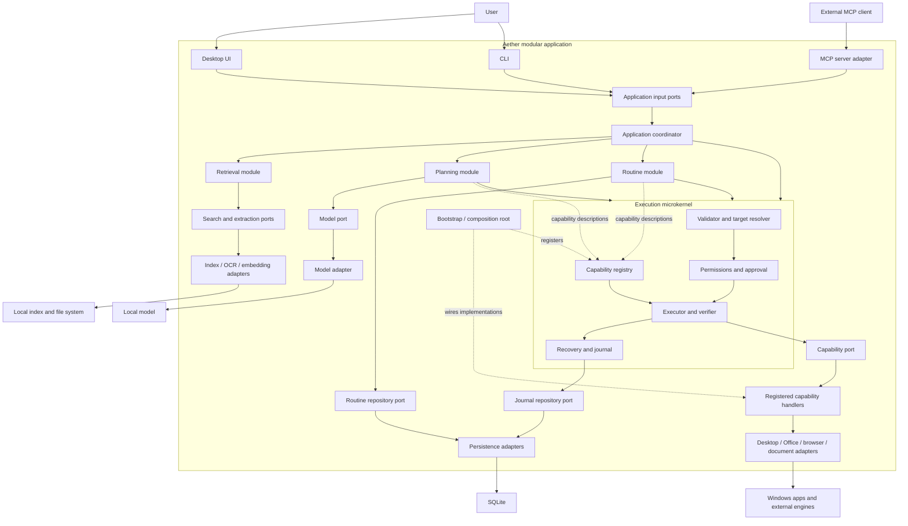
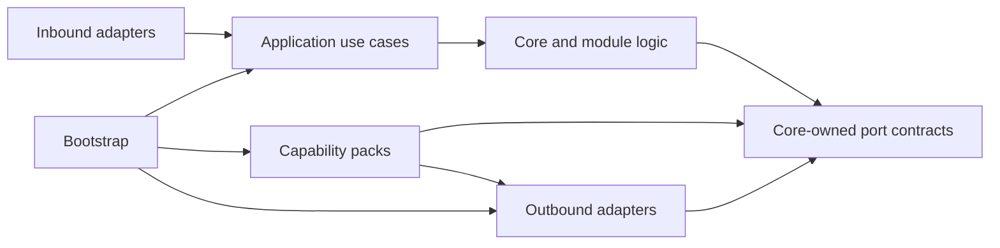
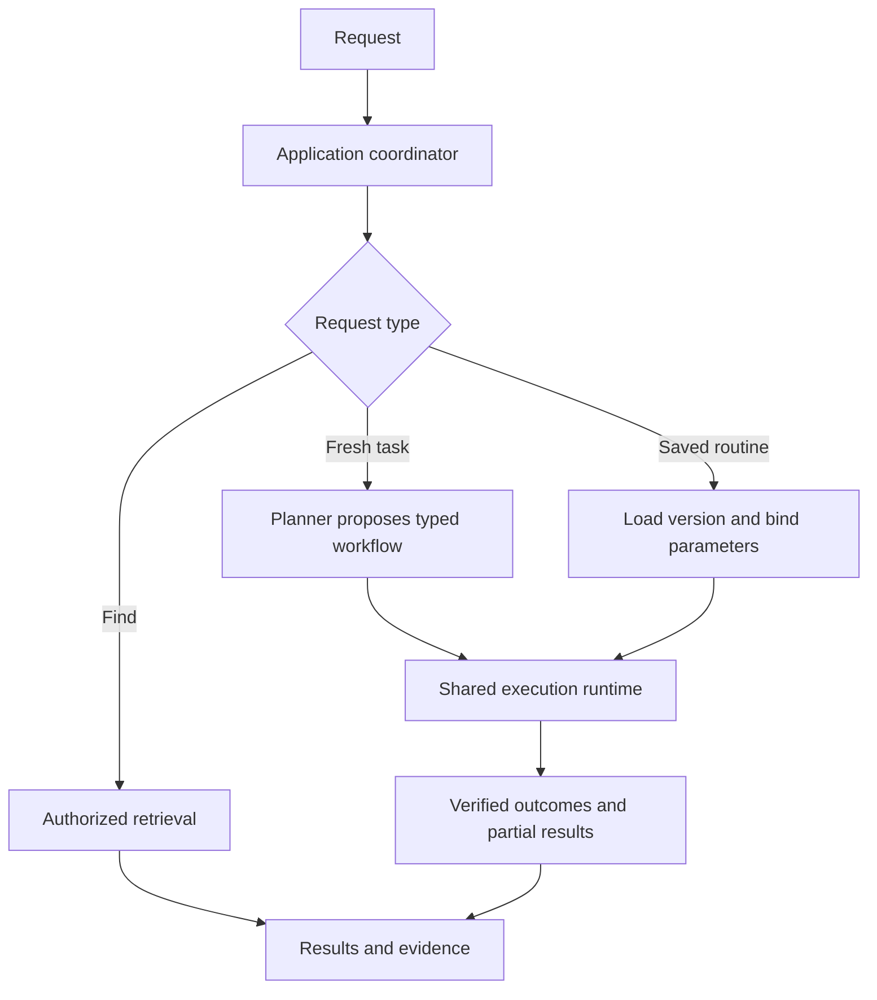
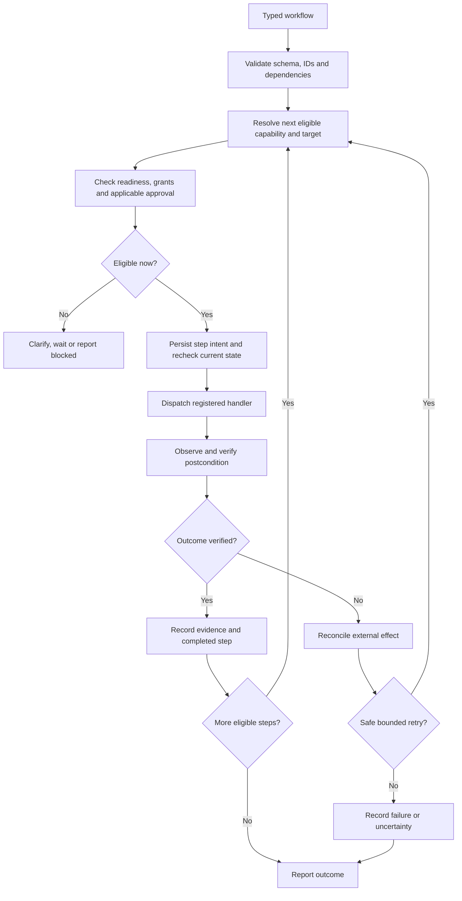
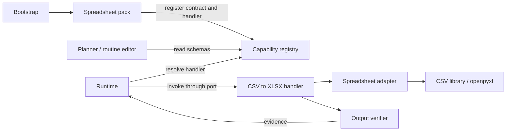

# Aether — Software Architecture

**Status:** Proposed design for team review · **Revision:** 0.1 · **Course:** SWE 4506, Design Project I

This document describes the target architecture, not an implemented system or a frozen Version 1.0 feature list. The requirements baseline remains the authority for product obligations; the v1.5 AI Development Context supplies technical constraints. Core, pilot and future classifications do not determine release inclusion by themselves.

## 1. Architectural decision

Aether is a local-first Windows assistant that finds information, performs supported tasks and replays verified routines. We propose a **modular monolith with hexagonal dependency boundaries and a microkernel-style capability execution subsystem**.

| Style | Role | Reason |
|---|---|---|
| Modular monolith (primary) | One deployable desktop application with explicit modules | Manageable integration and deployment for a three-person team |
| Hexagonal (ports and adapters) | Core-owned contracts isolate external technologies | Replaceable model, UI, storage and automation implementations; testability |
| Microkernel (execution subsystem) | Stable runtime and explicit capability registration | Add operations without changing the runtime when existing contracts suffice |

A single product may use bounded worker processes for inference, OCR and conversion. This does not require independently deployed microservices. Avoid unrestricted third-party plugin loading in the initial design.

## 2. Logical component map



Solid arrows show simplified calls or data flow; dotted arrows show catalog access or startup wiring, not source-code dependencies. Search-only results return through the application coordinator without requiring a fresh workflow plan. Search used within a workflow is dispatched as an authorized registered operation. All resource access, including indexing and search, uses applicable shared authorization policies.

### Responsibilities

| Component | Owns | Does not own |
|---|---|---|
| Inbound adapters | CLI, desktop UI, MCP request/response mapping | Authorization or direct execution |
| Application | Use-case coordination, routing, result presentation | Library-specific actions |
| Retrieval | Authorized indexing, ranking, evidence and source selection | Permission grants or task planning |
| Planning | Intent interpretation, relevant capability context, typed proposals and clarification | Authority to execute |
| Routines | Typed parameters, versions, compatibility, test and replay | A separate bypass executor |
| Runtime | Validation, target binding, dispatch, verification, bounded recovery | App-specific implementation |
| Security | Resource grants, effects, action-specific approval | AI-generated permissions |
| Registry | Operation schemas, routes, readiness and verifier contracts | Automatic grants or proof of support |
| Capability packs | First-party operation handlers, registration, operation-specific evidence | Changing core policy |
| Outbound adapters | Concrete OS, model, database and library integration | Release scope or execution authority |
| Bootstrap | Composition, dependency injection, explicit registration | Business decisions |

## 3. Dependency boundaries



Here arrows mean **source-code dependencies**. Core and functional modules must not import concrete Windows, Office, Qt, model or persistence implementations. Ports are owned by the application/core even if located in a separate package. Keep contracts free of implementation-specific types and avoid circular imports. Bootstrap constructs implementations and injects them; the runtime calls them via contracts. Ports may be Python Protocols or abstract base classes. Prefer the simplest contract sufficient for a real testable boundary.

## 4. Request paths



Direct known file/app requests can skip contextual search. A compatible, tested routine can skip fresh AI inference; offline replay additionally requires all dependencies to work offline. Ambiguous source or target selection pauses for clarification. Routine suggestions are not authority to execute.

## 5. Execution lifecycle



The validator rejects unknown capabilities, invalid arguments, duplicate IDs, forward/cyclic references and missing required verifiers. Each step is bound to current resource identities and versions. Approval is local, action-specific and invalidated by changes to relevant arguments, targets or effects. Journal intent before dispatch; record independent evidence afterward. An external UI effect cannot be made atomic with a database transaction. After interruption, reconcile before retry; do not blindly repeat uncertain effects. Cancellation stops future work, not already completed changes. Preserve completed, failed, cancelled and uncertain steps in the final report. Initial configurable limits from v1.5: eight mutating actions per fresh task, two recovery attempts per failed step, visible timeouts. Replanning never bypasses validation or approval.

## 6. Capability contract and extensibility

A capability is an operation such as `convert.csv_to_xlsx`. An adapter is a technological implementation; one adapter may serve several capabilities and one capability may have multiple tested routes. A pack groups operation handlers and registers them explicitly at startup. For simple operations the handler can itself be an adapter; do not duplicate layers unnecessarily.

| Contract field | Example |
|---|---|
| Stable operation ID and version | `convert.csv_to_xlsx` (catalog may expose `table.to_xlsx` as canonical alias target) |
| Typed input/output | Source CSV reference, new XLSX destination; resulting workbook reference |
| Preconditions and readiness probe | Supported format, dependency available, valid resource scope |
| Effects and permissions | Read source, create output; no overwrite |
| Execute | Registered handler invokes spreadsheet implementation |
| Verify | Reopen output, compare values and identifier types |
| Failure/evidence | Structured error, observable postcondition, source and output identity |



Registry states: Ready, Available to enable, Dependency missing, Unsupported. Recheck readiness before dispatch. A registered operation is not necessarily ready or tested. A fallback must satisfy the requested result and effects; disclose substitutions, and never count LibreOffice as success for a request specifically requiring Excel. Office routes may use COM, equivalent tested UIA, or equivalent file-level implementation; cached values are not live recalculation. Enabling a pack never grants resource access.

To extend Aether: implement an adapter if needed, define capability metadata and handler/verifier, add explicit registration, write contract and acceptance tests, update supported-operation documentation. The runtime should remain unchanged for compatible additions. A fundamentally new effect or security requirement may require changes to core contracts and review.

## 7. Proposed repository layout


```text
DP-1-Project_Aether/
├── src/aether/
│   ├── main.py
│   ├── bootstrap.py
│   ├── application/
│   │   ├── coordinator.py
│   │   └── use_cases/              # search, execute, save/run routine
│   ├── core/
│   │   ├── models/                 # intent, workflow, operation, result
│   │   ├── runtime/                # executor, validator, verifier, recovery
│   │   ├── capabilities/           # registry, manifest, readiness, resolver
│   │   └── security/               # permissions, approval, policies
│   ├── ports/
│   │   ├── inbound/                # search, execution, routine contracts
│   │   └── outbound/               # capability, model, storage, OCR, embedding
│   ├── modules/
│   │   ├── retrieval/              # index, keyword, semantic, hybrid, evidence
│   │   ├── planning/               # planner, context, clarification, replan
│   │   └── routines/               # builder, versions, binding, compatibility
│   ├── adapters/
│   │   ├── inbound/
│   │   │   ├── cli/
│   │   │   ├── desktop_ui/
│   │   │   └── mcp_server/
│   │   └── outbound/
│   │       ├── ai/
│   │       ├── desktop/
│   │       ├── documents/
│   │       ├── spreadsheets/
│   │       ├── office/
│   │       ├── browser/
│   │       ├── terminal/
│   │       ├── system/
│   │       ├── ocr/
│   │       ├── embeddings/
│   │       ├── mcp_client/
│   │       └── persistence/
│   └── extensions/
│       ├── document_pack/
│       ├── spreadsheet_pack/
│       ├── desktop_pack/
│       ├── browser_pack/
│       ├── developer_pack/
│       ├── system_pack/
│       └── text_pack/
├── tests/                         # unit, integration, contract, acceptance, fixtures
├── docs/
│   ├── requirements/
│   ├── architecture/
│   │   ├── README.md
│   │   └── ARCHITECTURE.md
│   ├── design/
│   └── evaluation/
├── configs/
├── scripts/
├── pyproject.toml
├── .gitignore
└── README.md
```

Python packages include `__init__.py` as appropriate. `bootstrap.py` is the composition root. Do not commit credentials, models, private indexes, user files, logs or local runtime data. Store local application data under an appropriate Windows user-specific directory such as `%LOCALAPPDATA%/Aether/`; use secure credential storage. User documents go to authorized destinations. Use synthetic fixtures in Git.

## 8. Technical mapping and data

| Concern | Proposed implementation direction |
|---|---|
| Schemas | Python, Pydantic; versioned UserIntent, WorkflowPlan, RunTrace |
| Retrieval | SQLite FTS5/BM25, multilingual E5-small embeddings, NumPy cosine and reciprocal rank fusion; Tesseract for visible text |
| Planner | Local model through a port; compare Qwen3 candidates via llama.cpp; Ollama can be a prototype adapter, not a frozen production choice |
| Desktop | PySide6 UI; UIA/pywinauto, tested APIs and foreground identity checks |
| Browser | Managed Chromium via Playwright; isolated profile, destination checks |
| Documents | pypdf, python-docx, openpyxl, tested LibreOffice routes; Office COM via dedicated STA worker where supported |
| Persistence | SQLite repositories, migrations, source revisions, routine versions, immutable run snapshots and redacted evidence |
| MCP | Local stdio client and server adapters; caller-scoped requests, status and cancellation through common runtime |
| Concurrency | Keep indexing/inference off UI thread; bounded workers; serialize foreground actions |

Store source IDs, content revisions, evidence locators, extraction status and matching index/vector versions. Exclude revoked scope immediately, even before cleanup. Preserve disconnected sources as unavailable rather than treating them as deleted. Native text and OCR must not double count. OCR is for visible writing, not general pictorial search. Low-confidence consequential values require confirmation. Model output is a proposal; arithmetic and conversions run in code.

## 9. Security and operational boundaries

- Run at standard user privilege; elevated or password dialogs require user handoff. Check actual target, foreground identity and current observation before input; pause on lock, takeover or unexpected dialog.
- Separate read and write grants. Resolve paths and junctions; check destination again at publication. Default to new copies, including Office work. The sole narrow overwrite exception in the technical baseline is explicitly approved `file.find_replace` with verified backup. No silent collision overwrite.
- Treat file, webpage, UI and model text as untrusted task data. Do not execute arbitrary model-generated commands; use reviewed bounded command families, exact command/shell/cwd approval and honest containment limits.
- Separate network permission from local permission. External planning receives only explicitly approved abstract/public fields, not private paths, passages, screenshots, credentials or history. Local MCP transport alone does not guarantee an external host's privacy.
- External MCP proposals use the same local validation and approval; scope resources and status to caller; deduplicate request keys and reject conflicting reuse. External tool declarations do not confer authority.
- Redact credentials and sensitive capture; support retention and removal controls. Exact retention periods remain undecided. No claim of universal application support or automatic rollback.

## 10. Requirements and verification mapping

| Requirement family | Architectural owner / evidence |
|---|---|
| FR_1–5 | Security; grant, revocation and network negative tests |
| FR_6–13 | Retrieval; ranked evidence, index consistency, denied scope |
| FR_14–19 | Planning; structured proposal, ambiguity and local inference |
| FR_20–27 | Runtime; validation, approval, effects, recovery and outcome tests |
| FR_28–67 | Registered handlers/adapters; per-operation postconditions (FR_46 superseded) |
| FR_68–79 | Routines; version, binding, compatibility and offline replay |
| FR_80–86 | Registry; readiness, extension contract and fallback tests |
| FR_87–93 | MCP; independent client/server interop, scope and cancellation |
| FR_94–103 | UI, runtime, persistence; progress, journal, recovery and privacy |
| FR_104–124, FR_126, FR_128–129 | Individual pilot/extension evaluations; no unsupported claims |
| FR_125 | Conditional evidence-backed summary or attributed extracts |
| FR_127 | Live spreadsheet write; verify changed cells and saved copy |
| NFRs | Cross-cutting safety, performance, support matrix and usability tests |

This is a family-level map, not a substitute for the baseline's detailed acceptance criteria. Use unit tests for pure logic, contract tests for handlers, integration tests for runtime/adapters, and acceptance tests for user outcomes on Windows. Record actual dependencies, app versions, evidence, failures and unsupported cases. No test is claimed passed by this design.

## 11. Initial skeleton and development approach

Start with the shared workflow schema, registry, policy/approval contracts, executor, verifier and durable journal, together with a minimal CLI. Use a deterministic fixture planner to test the runtime before relying on model inference. Implement scoped search and the first conversion slice in parallel, preserving the v1.5 search-first delivery objective. Register CSV-to-XLSX, then PDF-to-DOCX as a separate extensibility exercise. Integrate the local planner and demonstrate find → choose → convert → open → verify on Windows. Later add versioned routine replay, UI and additional adapters as scope is agreed. The technical baseline targets an end-to-end workflow by Week 8; actual schedule and release inclusion require team review.

Initial test: run the same executor with two different registered handlers, verify outputs independently, deny an unauthorized destination, reject an unknown capability, and reconcile a simulated interrupted run. A second handler should not require editing executor logic if the existing contract suffices.

Ownership proposal: retain the v1.5 split (A: native/browser/Office and verification; B: retrieval/planning/conversion; C: UI/routines/journal/packaging), with shared runtime contracts and cross-review. Confirm individual assignments before implementation.

## 12. Trade-offs and open decisions

| Decision / risk | Disposition |
|---|---|
| Too many abstractions | Begin with one capability port; split only when needed |
| Shared-process failure | Isolate expensive/failure-prone engines with bounded workers where justified |
| Unsafe plugin code | Explicit reviewed first-party registration; not a sandbox guarantee |
| App/version variability | Publish tested support matrix; pilots scored separately |
| Model quality and hardware | Benchmark before selection; numerical latency/RAM/disk thresholds pending |
| Version 1.0 scope | Open; priorities provisional, safety mandatory for included features |
| Data retention, routine removal, OCR threshold and export semantics | Pending requirements decisions; do not silently freeze defaults |

## 13. References and change control

- Aether Requirements Baseline — simplified working copy (Draft 1.1).
- Aether AI Development Context v1.5 (20 November 2026), especially command lifecycle, capability contracts, local integration and delivery sections.
- DP-I Aether SRS and Final Build Guide as supporting requirement/technical references.

Changes to architectural contracts should record rationale, affected requirements, compatibility and test impact. Changes to release commitments need explicit team/supervisor disposition as applicable. The proposed style combination, package boundaries and diagrams are design recommendations awaiting review.
