# Aether — Design Patterns

> Revision 0.1 | Proposed for team review | SWE 4506 — Design Project I

Companion to [ARCHITECTURE.md](ARCHITECTURE.md) and [MODULE_DESIGN.md](MODULE_DESIGN.md). Aether follows a modular monolith with hexagonal boundaries and a microkernel-style execution subsystem. This document selects patterns that solve concrete problems in that architecture; it does not require a separate class for every pattern. All diagrams and names are design sketches, not implemented code.

## 1. Pattern selection

| Pattern / technique | Category | Aether responsibility | Adoption |
|---|---|---|---|
| Command | GoF behavioral | Uniform operation handlers | Foundation |
| Adapter | GoF structural | External technology integration | Foundation |
| Registry | Design idiom | Capability discovery and dispatch | Foundation |
| Dependency Injection | Design technique | Composition and dependency isolation | Foundation |
| Chain of Responsibility | GoF behavioral (adapted validation pipeline) | Sequential mandatory checks | Foundation (simple pipeline first) |
| Repository | Persistence pattern | Module-owned durable state | Foundation for journal; expand as needed |
| State machine / State | Lifecycle technique / GoF behavioral | Step and run transitions | Explicit state machine first |
| Strategy | GoF behavioral | Retrieval, planning and equivalent routes | As alternatives are integrated |
| Simple Factory / Factory Method | Creation idiom / GoF creational | Construct configured implementations | Simple factory first |
| Facade | GoF structural | Uniform client use cases | As client interfaces are integrated |
| Observer | GoF behavioral | Progress and status events | As progress reporting is integrated |
| Composite, Builder, Template Method, Decorator, Proxy, Specification | Optional | More complex behavior where warranted | Conditional; not required by initial skeleton |

Registry, Repository, Simple Factory, Dependency Injection, Specification and a finite-state machine are useful techniques but not additional GoF patterns. Adoption phases describe abstractions, not postponement of security or release priorities.

## 2. Command — uniform capability execution

**Problem:** Aether must execute different operations (conversion, file opening, settings) without branching on every operation in its executor.

**Design:** A serializable workflow step is a data request. A registered command handler is the implementation of that request. The runtime acts as invoker; adapters are receivers. A bound action is produced only after validation and resource resolution. Verification is explicit and observes actual external state rather than accepting a handler's success flag.

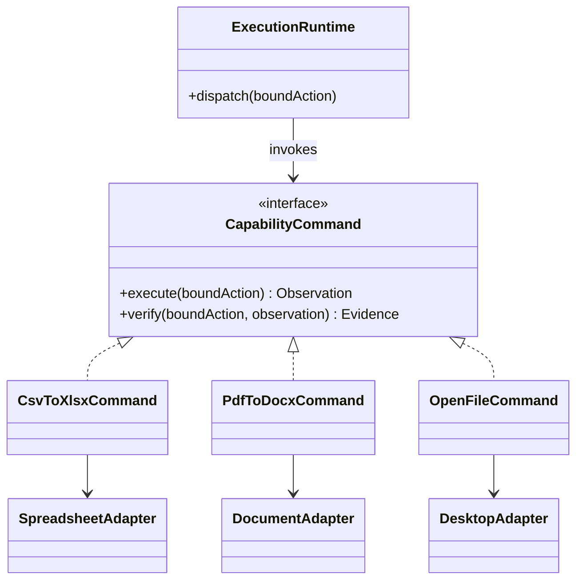

**Participants:** `ExecutionRuntime` coordinates execution; `CapabilityCommand` is the contract; concrete commands supply operation-specific behavior; adapter implementations perform external calls. The registry supplies the selected handler. A handler may also implement the adapter directly for a simple operation.

**Location:** `core/runtime/`, `ports/outbound/capability_port.py`, `extensions/`.

**Requirements:** FR_15, FR_20–27, FR_28–67, FR_68–76, FR_80–86. **Evidence:** two registered conversion commands use one executor; an unauthorized command never reaches its receiver; verification checks real output. Serialize IDs and arguments, not live objects or arbitrary code. Do not assume undo is possible.

## 3. Adapter — isolate external interfaces

**Problem:** Windows UIA, Office COM, model runtimes and document libraries expose incompatible APIs. Core logic must remain independent of them.

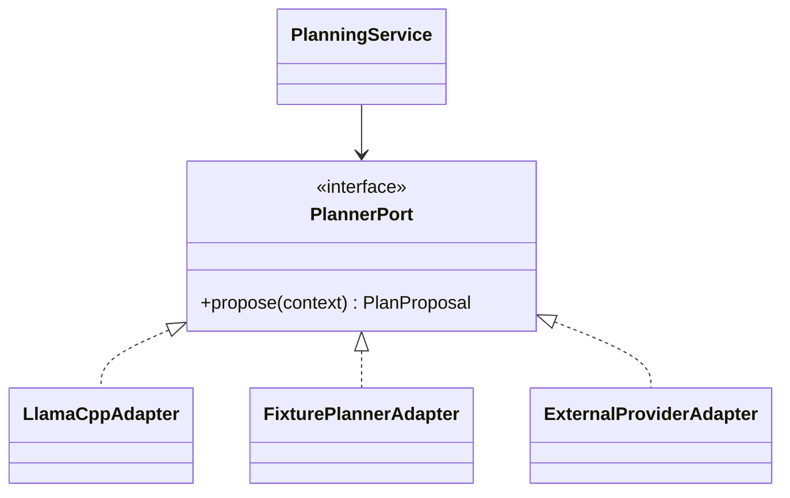

The interface belongs to the application/core; concrete adapters implement it. The fixture adapter supports deterministic tests. The external provider is optional, planning-only and subject to explicit disclosure rules. Local model selection is not frozen. Apply the same approach to OCR, embeddings, storage, Office, browser and desktop automation. An adapter is not automatically a registered capability: one adapter may support several operations, and one operation may have several verified equivalent routes.

**Location:** `ports/`, `adapters/`. **Requirements:** FR_19, FR_28–67, FR_84–85, FR_87–93, FR_111. **Evidence:** core tests run with fake ports without Windows/Office; equivalent adapter can be substituted without modifying core logic; unsupported app-specific outcomes are not silently substituted.

## 4. Registry — extensible capability lookup

**Problem:** The planner, routine builder and runtime need one consistent catalog of operation IDs, schemas, effects, readiness and implementations.

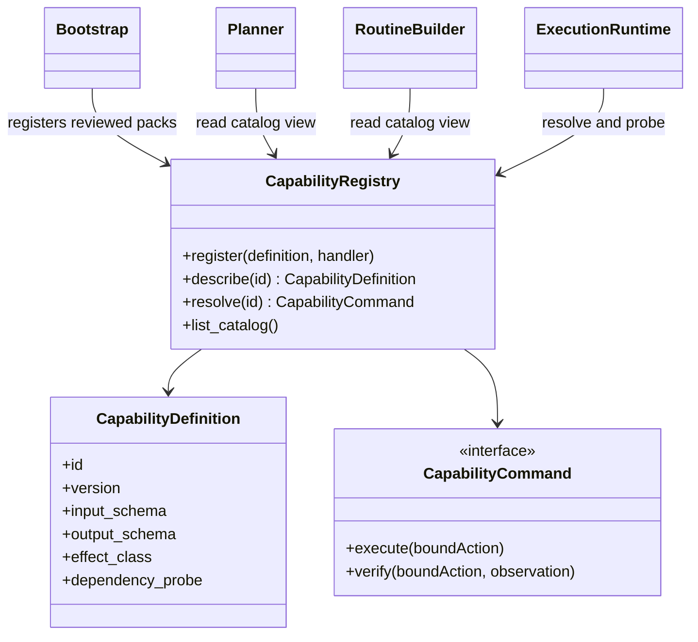

Registration validates uniqueness and completeness. Catalog readiness is distinct from authorization and tested product support. A disabled/missing operation is not dispatchable. Preserve the catalog's canonical IDs and explicit aliases (for example `table.to_xlsx` / `convert.csv_to_xlsx`), rather than creating incompatible identifiers in different modules. Initial implementation uses explicit first-party manifests, not unrestricted dynamic loading.

**Location:** `core/capabilities/`, `extensions/`, `bootstrap.py`. **Requirements:** FR_80–86, FR_15, FR_68–76. **Evidence:** add PDF-to-DOCX after CSV-to-XLSX without changing executor; reject duplicate IDs, invalid schemas and missing verifier; show readiness changes and recheck before dispatch.

## 5. Chain of Responsibility — mandatory validation pipeline

**Problem:** An operation may have valid syntax but still lack a dependency, current target identity, grant or approval. Each check needs a clear responsibility and a fail-closed outcome.

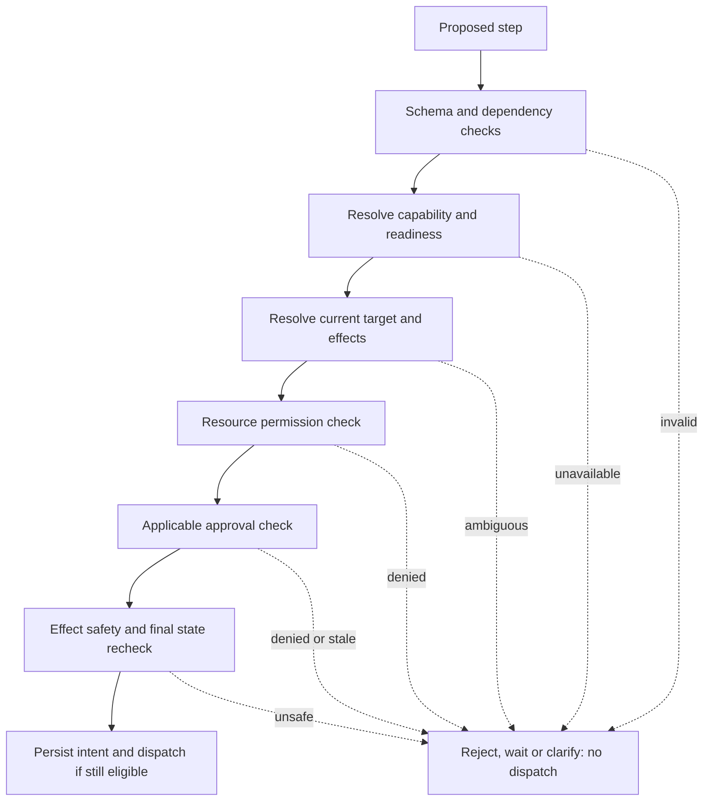

This is a pipeline variation, not a chain where the first accepting handler executes the operation. Every applicable check must pass. Start with a small sequence of functions returning structured decisions; separate handler classes only if useful. Resolve actual identities under appropriate grants and revalidate immediately before effects. Approval binds the action digest, not just a broad user instruction. No check may be skipped by a plugin or an external MCP client.

**Location:** `core/runtime/validator.py`, `core/security/`. **Requirements:** FR_1–5, FR_20–25, FR_90–92; applicable security NFRs. **Evidence:** parameterized negative tests for each check, revoked grant, changed target and expiry; no effect or dispatch when blocked. File output publication remains collision-safe even after preview.

## 6. Strategy — interchangeable behavior

**Problem:** Search and execution can have different valid approaches. Selection should not force callers to implement every algorithm.

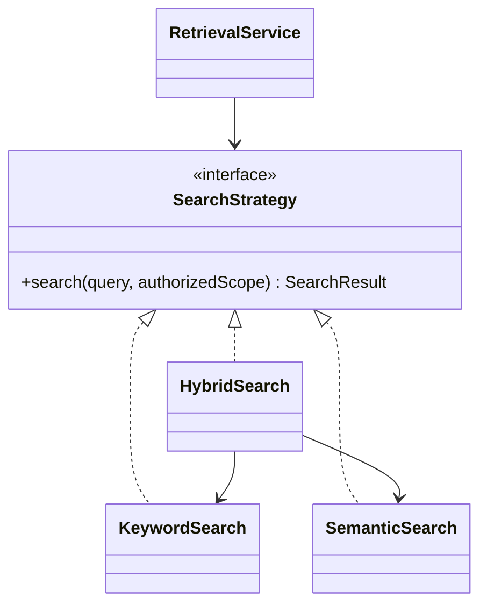

Keyword retrieval uses lexical relevance; semantic retrieval uses embeddings; hybrid retrieval combines rankings and preserves evidence. Scope filtering applies to each approach. Other strategy candidates include model proposal selection and Office route selection (COM, equivalent tested UIA, equivalent file route). File-only requests start at file level. A timeout requires reconciliation before fallback; cached spreadsheet values cannot certify live recalculation. Strategy chooses a behavior; Adapter reconciles an external interface. Both can appear in the same class without unnecessary duplication.

**Location:** `modules/retrieval/`, `modules/planning/`, `core/capabilities/resolver.py`. **Requirements:** FR_7–11, FR_19, FR_50–53, FR_84, FR_127. **Evidence:** compare retrieval methods on the same fixtures; exercise unavailable Office routes, incompatible substitutes and observable output equivalence.

## 7. Observer — communicate progress without UI coupling

**Problem:** CLI, desktop UI and authorized MCP clients need progress updates without the runtime importing interface code.

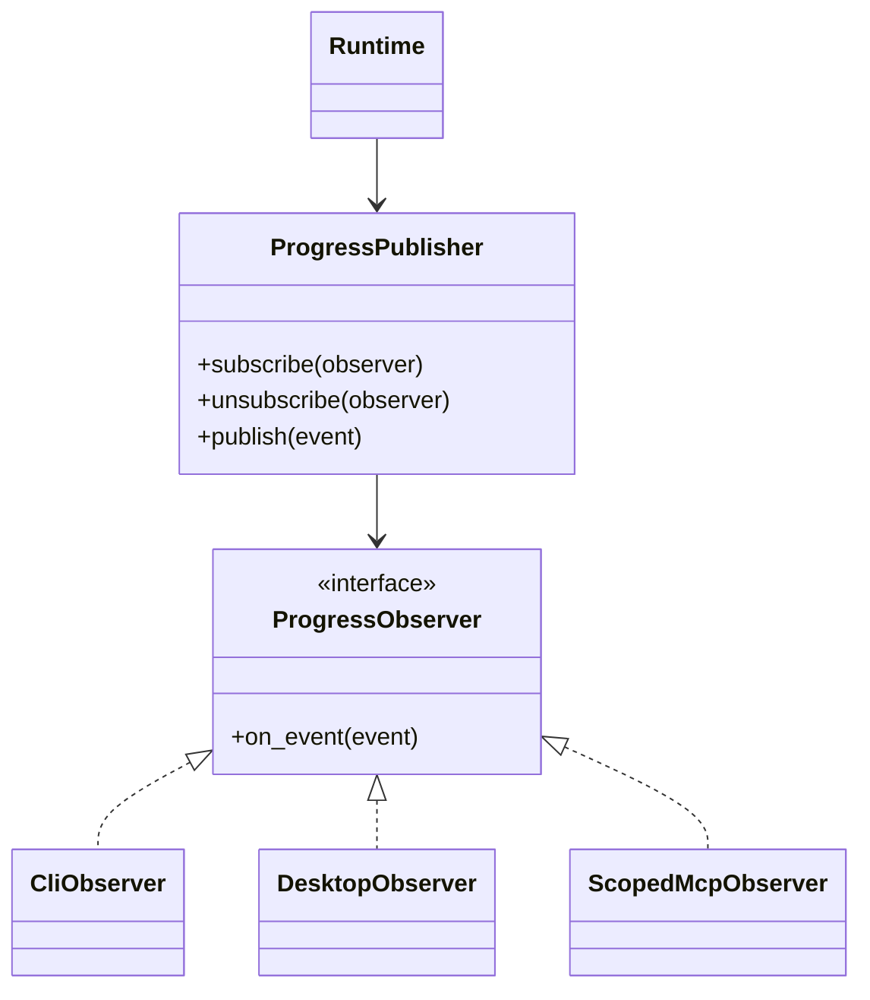

Events can include step started, approval required, verified step outcome, cancellation requested and workflow outcome. Route Qt updates onto the UI thread; do not expose private event content to unauthorized clients. Observer notifications are not the durable journal. Persist critical intent/outcome explicitly; observer failures must not fabricate success or erase evidence. MCP notifications or polling depend on the supported protocol surface.

**Location:** `core/runtime/`, `adapters/inbound/`. **Requirements:** FR_92–96, FR_98–99. **Evidence:** several listeners receive permitted events; failed subscriber does not alter execution; disconnected/reconnected UI reads durable status; no private event leakage.

## 8. Factory and Dependency Injection — wire implementations

**Problem:** Choosing and constructing concrete adapters inside business logic makes substitution and testing difficult.

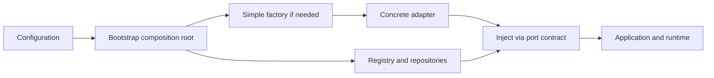

Bootstrap constructs the implementations, injects them through constructors and registers first-party packs. Use simple functions or an explicit configuration mapping initially. Use GoF Factory Method only if subclasses genuinely need to specialize creation; Abstract Factory is not necessary without families of related products. Dependency injection is distinct from a global registry: inject the registry where capability lookup is needed, rather than treating it as a general service locator. Model/provider selection never creates new permissions.

**Location:** `bootstrap.py`, adapter-local creation helpers. **Requirements:** FR_19, FR_80–85; extensibility and reproducible setup NFRs. **Evidence:** compose the application with a fixture planner and in-memory repositories; separately compose real adapters without changing consumers.

## 9. Facade — common application entry point

**Problem:** Multiple clients should not individually orchestrate planning, retrieval, execution and security.

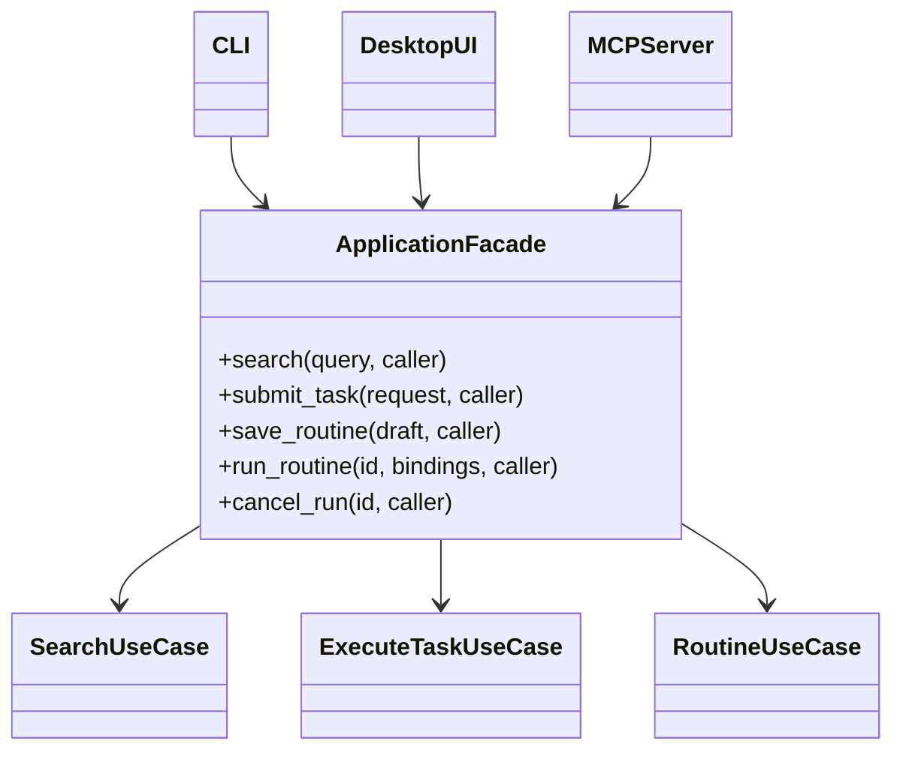

The facade is a thin entry point for application use cases, not a god object. Caller scope and local approval remain enforced. MCP need not expose every facade method. Search-only and compatible routine replay need no fresh planning model.

**Location:** `application/`, `ports/inbound/`. **Requirements:** FR_14–19, FR_68–79, FR_87–96. **Evidence:** CLI and MCP proposals reach the same runtime, scoped status/cancel and local approval; standalone search does not require the planner.

## 10. State machine / State — explicit lifecycle

**Problem:** Aether must distinguish actual verified effects, in-progress work, denial, cancellation, failure and uncertainty.

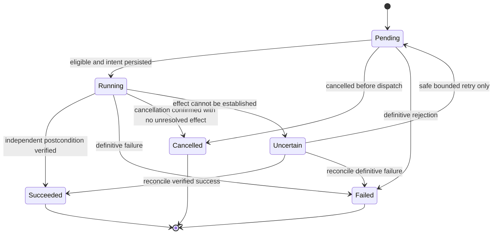

This diagram describes durable step states. Waiting for clarification/approval, blocked, and reconciling are active run conditions, not interchangeable with step outcomes. Task results aggregate actual steps (completed, partial, failed, cancelled, uncertain). A cancellation request while an effect is in flight does not establish cancellation of that effect. Never mark a step succeeded merely because dispatch returned. An uncertain outcome may remain unresolved and be reported. An explicit enum plus allowed-transition table is sufficient initially; introduce GoF State objects if per-state behavior becomes complex. The safe retry transition requires reconciliation, current validation and applicable approval; maintain attempt history.

**Location:** `core/runtime/state_manager.py`, journal and recovery. **Requirements:** FR_24–27, FR_95–100. **Evidence:** illegal transitions rejected; crash windows reconciled; no duplicate effect or false success; completed steps survive cancellation.

## 11. Repository — durable module-owned state

**Problem:** Business modules should not depend on SQLite implementation details or directly modify another module's data.

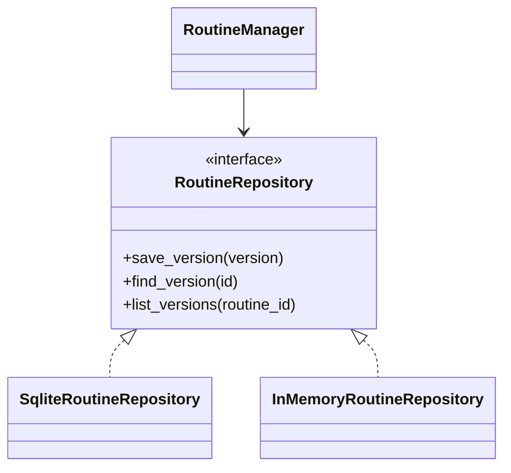

Use separate domain-oriented contracts for routines, grants, indexes and journal. They may share one physical SQLite database with controlled ownership and migrations. Store immutable run snapshots separately from editable routine versions. Journal intent before effect and evidence afterward; database transactions do not cover external UI or file effects. Exact retention and routine removal semantics remain open. An in-memory implementation is useful for unit tests but cannot prove crash durability.

**Location:** `ports/outbound/repository_port.py`, `adapters/outbound/persistence/`. **Requirements:** FR_68–79, FR_97–103, FR_1–3. **Evidence:** version and scope isolation, restart persistence, real SQLite crash tests, no stale routine changes to old run history.

## 12. Conditional patterns — avoid premature abstractions

| Pattern | Candidate use | Introduce when |
|---|---|---|
| Composite | Nested groups of workflow steps | Nested composition is explicitly supported; a typed list/dependency graph is sufficient initially |
| Builder | Construct and validate multi-step routine drafts | Incremental authoring has meaningful construction complexity |
| Template Method | Share invariant handler procedure | Repeated implementations justify inheritance; prefer composition for global safety checks |
| Decorator | Timing, diagnostics, instrumentation | Cross-cutting duplication appears; must not skip authorization or verification |
| Proxy | Mediated access to specific resources | A real access mediation boundary exists; not an OS sandbox claim |
| Specification | Compose reusable authorization predicates | Rule composition becomes complex; fail closed with explicit decisions |

No conditional pattern is a release commitment. Avoid Singleton/global mutable state for the registry, permissions or journal: explicit dependency injection is easier to test and isolates application instances.

## 13. How the patterns cooperate

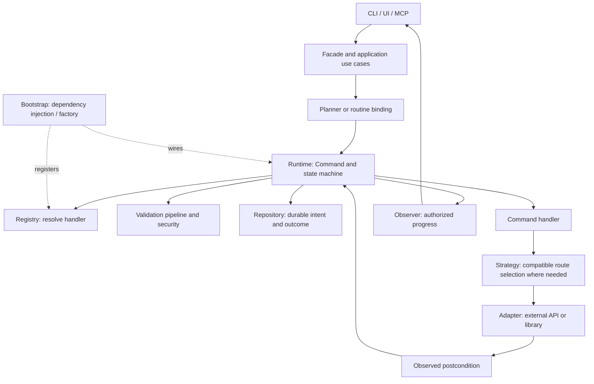

Arrows summarize relationships, not mandatory ordering. Resolve, authorize and record intent before dispatch; route selection that changes target/effect requires revalidation. Verification and recovery are shared runtime responsibilities with capability-specific evidence. The planner proposes but cannot execute a handler directly.

### Concrete example: CSV-to-XLSX

1. Facade accepts the task and invokes planning (or binds a saved routine).
2. Registry supplies the conversion schema and handler. The runtime validates the plan and resolves the actual source/destination.
3. Validation pipeline checks readiness, read/write grants, applicable approval and effect safety. Journal persists intent before the effect.
4. Command handler uses a spreadsheet adapter to parse CSV and create a new XLSX; preserve text identifiers and prevent executable formula injection. Publish collision-safely.
5. Independent verification reopens the workbook and compares values and types. Repository persists evidence; state machine records the actual outcome; Observer updates clients.
6. A subsequent file-opening step runs only when prerequisites are met and verifies the intended document/app independently.

### Architecture mapping

| Architectural style | Primary supporting patterns |
|---|---|
| Modular Monolith | Facade, Repository, Observer, explicit module interfaces |
| Hexagonal | Adapter, Strategy, Dependency Injection, Simple Factory |
| Microkernel | Command, Registry, validation pipeline, state machine |

The mappings are not exclusive. Architectural dependency boundaries apply across all modules.

## 14. Adoption and verification plan

| Stage | Introduce | Demonstration |
|---|---|---|
| Initial skeleton | Command, Adapter, Registry, DI, simple validation pipeline, journal repository, explicit state transitions | CLI with fixture planner; authorized conversion and denial tests |
| Extension test | Second registered command and adapter | PDF-to-DOCX without executor edits if contract suffices |
| Retrieval/planning | Strategy and simple factory as real alternatives emerge | Scoped search and local model integration |
| Reuse and clients | Routine repository, facade, observer | Versioned replay, status and cancellation through common use cases |
| Expansion | Additional patterns only where justified | Individual contract and acceptance evidence |

Mandatory safeguards apply from the first executable slice. Tests should check behavior, not merely class names or pattern counts. Use unit tests for pure logic, contract tests for capability and adapter interfaces, integration tests for persistence and execution, and Windows acceptance tests for actual user outcomes. No tests or implementation are claimed complete.

## 15. References and change control

- [Architecture overview](README.md), [detailed architecture](ARCHITECTURE.md), [module design](MODULE_DESIGN.md).
- Aether Requirements Baseline Draft 1.1 (simplified working copy) and Aether AI Development Context v1.5.
- Pattern terminology: Gamma, Helm, Johnson and Vlissides, *Design Patterns: Elements of Reusable Object-Oriented Software* (1994); Fowler, *Patterns of Enterprise Application Architecture* (2002), for Repository terminology.

The pattern selection and UML-style participant names are proposals. Review against actual contracts before coding; record any changes to boundaries, requirement mappings and acceptance evidence. The development layout is `src/aether/`; Version 1.0 inclusion remains open.
