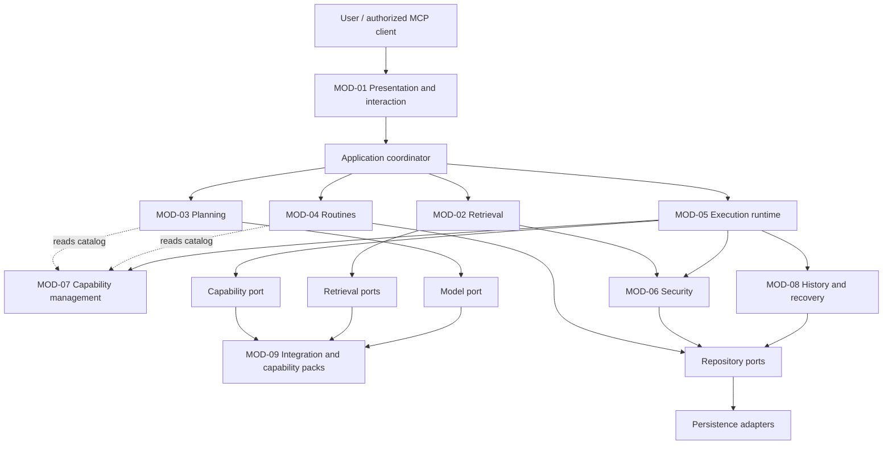
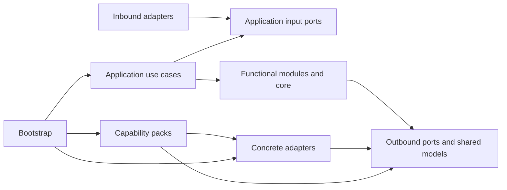
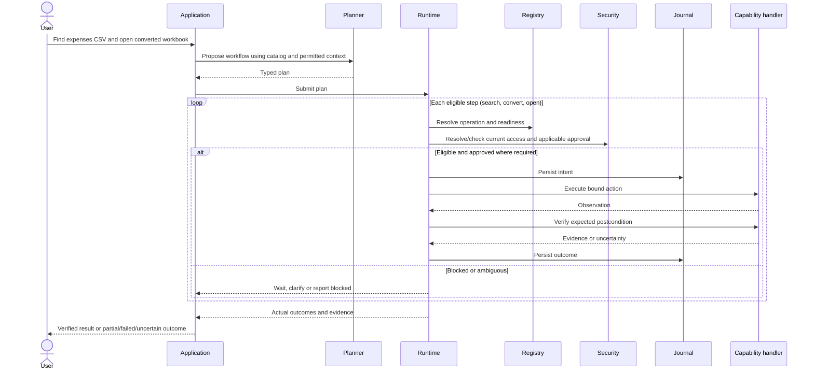

# Aether — Module Design

> Revision 0.1 | Proposed for team review | SWE 4506 — Design Project I

Companion to [ARCHITECTURE.md](ARCHITECTURE.md) and [DESIGN_PATTERNS.md](DESIGN_PATTERNS.md). This document defines logical module boundaries, responsibilities, interfaces and verification obligations. It is not an implementation report or a commitment to deliver every feature in Version 1.0. The team has selected the Python `src/` layout for development.

## 1. Module map

Aether is one deployable application. The application coordinator orchestrates use cases; functional modules own their logic and data. Hexagonal ports isolate external technology, and the execution microkernel dispatches registered capabilities. Internal calls are ordinary Python calls unless a worker or external protocol boundary requires otherwise.



Arrows represent calls or information access, not source import direction. The coordinator submits fresh plans and bound routines to the same runtime. A search-only request can return directly through authorized retrieval. A search step in a workflow goes through the common runtime and a registered search handler. Model output, search results and MCP messages cannot grant authority.

## 2. Module inventory

| ID | Module | Primary package | Owned responsibility | Primary requirement family |
|---|---|---|---|---|
| MOD-01 | Presentation and interaction | `adapters/inbound/` | CLI, desktop UI, MCP request/response mapping | FR_87–93, FR_94–96, FR_102 |
| MOD-02 | Retrieval | `modules/retrieval/` | Indexing, ranking, evidence and selection | FR_6–13, FR_125 (joint) |
| MOD-03 | Planning | `modules/planning/` | Intent, typed proposals, clarification, bounded replanning | FR_14–19, FR_125 (joint) |
| MOD-04 | Routines | `modules/routines/` | Authoring, versions, parameters, compatibility and replay preparation | FR_68–79, FR_101 (joint) |
| MOD-05 | Execution runtime | `core/runtime/` | Validate, schedule, authorize via security, dispatch and verify | FR_20–27, FR_95–100 (joint) |
| MOD-06 | Security | `core/security/` | Grants, approval, privacy and effect policy | FR_1–5, FR_21–25, FR_90–92, FR_103 (joint) |
| MOD-07 | Capability management | `core/capabilities/` | Schemas, registration, readiness and compatible routing | FR_80–86 |
| MOD-08 | History and recovery | `core/runtime/` and repository ports | Intent journal, evidence, snapshots, reconciliation | FR_26–27, FR_97–103 |
| MOD-09 | Integration | `adapters/outbound/`, `extensions/` | Actual technology calls and operation-specific verification | FR_28–67, FR_87–89 (joint), FR_104–124, FR_126–129 |

This is a family-level allocation, not exhaustive traceability. FR_46 is superseded by the expanded extraction obligation; it is not a separate active implementation task. FR_127 covers live spreadsheet writing; FR_128 and FR_129 are distinct pilots. Source classification and provisional priority do not select a release. The application coordinator and persistence infrastructure are supporting components, not additional business-module IDs.

## 3. Module specifications

All interface signatures below are illustrative Python-style contracts, not committed class definitions. Each module exposes a small public interface (for example `service.py` or a package export); callers do not import private helpers or directly edit another module's tables. Resource references and caller context must be resolved and checked by trusted code, not accepted as authority from clients.

### MOD-01 — Presentation and interaction

- **Owns:** input normalization, displaying clarification and approval prompts, progress/results, cancellation requests, scoped MCP request mapping.
- **Does not own:** permissions decisions, execution dispatch, verified status or database access.
- **Public interactions:** `submit_task(request, caller)`, `search(query, caller)`, `run_routine(id, bindings, caller)`, `cancel_run(run_id, caller)` through application input ports; subscribe to authorized progress events.
- **Components:** CLI controller, desktop controller/view model, MCP server adapter, event presenter. PySide6 is the intended desktop toolkit; CLI first.
- **Dependencies:** application input ports and event contracts only; the local approval UI collects decisions for MOD-06. MCP status/cancel is caller-scoped and external proposals require local authorization. Duplicate request keys return the original run; conflicting reuse is rejected.
- **Data ownership:** transient presentation state, no authoritative execution state.
- **Verification:** denied external request cannot dispatch; local approval required where applicable; UI shows partial/uncertain results accurately; cancellation does not imply rollback; UI remains responsive during background work.

### MOD-02 — Retrieval

- **Owns:** authorized source discovery, extraction status, source revisions, chunks, lexical/vector indexes, ranking, evidence and candidate selection support.
- **Does not own:** grants, planning or arbitrary file mutations.
- **Public interface:** `index(scope, context)`, `refresh(source_ref, context)`, `search(query, scope, context) -> SearchResult`, `resolve_candidate(candidate_id, context) -> SourceRef`.
- **Components:** source scanner, versioned extractors, index manager, keyword and semantic strategies, hybrid ranker, evidence builder.
- **Dependencies:** MOD-06 authorization; extraction, OCR, embedding and index repository ports. Candidate IDs are not permission tokens.
- **Data ownership:** documents, chunks, OCR regions, extraction revisions and index manifest. Keep text/vector revisions consistent, exclude revoked sources immediately, mark disconnected sources unavailable rather than deleted.
- **Technical direction:** SQLite FTS5/BM25, multilingual E5-small, NumPy cosine, reciprocal rank fusion, local Tesseract. Index supported TXT/CSV/DOCX/PDF/PNG/JPEG and local HTML where supported; use OCR on pages without usable native text. Return locations, status and evidence, not just filenames. General pictorial search is outside the contract.
- **Verification:** native and OCR retrieval fixtures, ambiguous candidate handling, revoked scopes, changed/deleted/disconnected sources, encrypted/corrupt inputs and rank/evidence evaluation. Consequential low-confidence OCR requires confirmation; Bengali support remains an evaluation question.

### MOD-03 — Planning

- **Owns:** interpreting intent, preparing relevant catalog context, generating typed workflow proposals and requesting clarification or bounded replanning.
- **Does not own:** direct Windows actions, grants, approval, arithmetic, conversion or success claims.
- **Public interface:** `propose(intent, observations, catalog_view) -> PlanProposal`, `replan(plan, observation, remaining_budget) -> PlanProposal`.
- **Components:** intent interpreter, context builder, model gateway, schema parser, clarification policy, replanning coordinator.
- **Dependencies:** model port, read-only capability catalog, scoped retrieval through application coordination. Local model primary; external planning only through explicit approved abstract/public fields, with private binding local.
- **Data ownership:** transient proposal/context; accepted workflow versions belong to routine storage, actual run snapshots to history.
- **Verification:** valid/invalid JSON, unknown capability, missing parameters, ambiguity, held-out combinations, bounded replan, private-marker tests and no direct dispatch. Benchmark model candidates before selection. Conditional summaries must be evidence-backed or fall back to attributed excerpts.

### MOD-04 — Routines

- **Owns:** card-based or verified-history authoring, typed inputs, drafts, versions, compatibility, test requests and replay preparation.
- **Does not own:** independent executor, automatic grants, automatic execution based on similarity.
- **Public interface:** `create_draft(source)`, `bind(version_id, inputs, context) -> WorkflowPlan`, `save_version(draft)`, `request_test(version_id, bindings)`, `list_routines()`; edits produce a new version and invalidate relevant test eligibility.
- **Components:** routine manager, builder, parameter binder, version manager, compatibility checker and preference resolver.
- **Dependencies:** routine repository port, catalog view, application test/replay use cases. All actual test and replay runs use MOD-05 with fresh checks.
- **Data ownership:** routine definitions, versions, parameter schemas and test references; approved scoped preferences through their designated repository. Immutable run snapshots stay with MOD-08. Deletion/retention details remain open.
- **Verification:** compatible planner-free replay, incompatible blocked replay, parameter type failures, disabled/missing capabilities, revoked grants, edited routine requiring retest; offline replay only when dependencies are offline-compatible.

### MOD-05 — Execution runtime

- **Owns:** workflow compilation, dependency ordering, target resolution coordination, eligibility checks, intent recording, dispatch, independent postcondition evaluation, cancellation and bounded retry coordination.
- **Does not own:** concrete app libraries, AI-generated authority, UI rendering or unconditional fallback.
- **Public interface:** `submit(plan, context) -> RunRef`, `advance(run_id)`, `request_cancel(run_id, context)`, `get_status(run_id, context) -> RunStatus`.
- **Components:** validator, scheduler, executor, target resolver, verifier, lifecycle state machine and foreground ownership controller.
- **Dependencies:** MOD-06 authorization, MOD-07 resolver, MOD-08 journal/reconciliation, capability port, progress event sink. Optional replan requests return through application coordination, avoiding a runtime-to-planner import cycle.
- **Data ownership:** transient execution coordination; durable run/step records owned by MOD-08. One run owns foreground automation at a time.
- **Verification:** unknown IDs, invalid schemas and dependency references, denied/stale approval, changed targets, collisions, cancellation, verified partial results and uncertain effects. Initial configurable limits: eight mutating operations per fresh task, two recovery attempts per failed step; visible deadlines. Every dispatch is revalidated; unsafe recovery stops or asks the user.

### MOD-06 — Security

- **Owns:** distinct read/write grants, authorized app/network scopes, effect policy, approval decisions, revocation and disclosure rules.
- **Does not own:** planning, actual external operation or release selection.
- **Public interface:** `authorize_access(resource, effect, context)`, `evaluate_action(bound_action, context) -> Decision`, `record_local_approval(action_digest, decision, expiry)`, `revoke(grant_id)`.
- **Components:** grant service, canonical resource resolver policy, approval manager, network/disclosure policy, file protection and capture policy.
- **Dependencies:** grant/approval repository and resource identity observation ports. Actual filesystem/window/network observations come from adapters.
- **Data ownership:** grants, approvals, policy settings. Approval binds run/step, operation and adapter version, normalized arguments, resolved resources, effects and relevant versions; change or expiry invalidates it.
- **Verification:** denied access before read or effect, revoked index/routine handles, changed approval digest, path/junction and redirect cases, collision protection, external disclosure markers. Run as standard user; hand off elevation/password dialogs. New outputs default; sole approved backed-up in-place exception is `file.find_replace`. This is not a sandbox guarantee for arbitrary subprocesses.

### MOD-07 — Capability management

- **Owns:** unique stable capability IDs, versioned schemas, effect declarations, handler/verifier bindings, dependency probes, readiness and tested alternative routing.
- **Does not own:** execution authority or guarantee of support from registration alone.
- **Public interface:** `register(definition, handler)`, `describe(id)`, `list_catalog(context)`, `resolve(id, requested_outcome)`, `probe(id)`.
- **Components:** registry, manifest loader, readiness service and route resolver. Bootstrap registers reviewed first-party packs explicitly. No arbitrary downloaded plugin code.
- **Dependencies:** capability contract and readiness probes; no concrete pack imports in core.
- **Data ownership:** catalog metadata and enabled-pack configuration. States: Ready, Available to enable, Dependency missing, Unsupported. Enabling a pack grants no extra permission.
- **Verification:** duplicate/unknown ID rejection, schema/handler mismatch, unavailable dependencies, compatible route selection, no silent substitution, independent extension exercise without executor changes. Recheck readiness before dispatch.

### MOD-08 — History and recovery

- **Owns:** durable intent, step outcomes, evidence, run snapshots, reconciliation and retention operations.
- **Does not own:** arbitrary retry decisions or unverified success.
- **Public interface:** `record_intent(bound_action, key)`, `record_outcome(step, evidence)`, `load_run(run_id)`, `find_uncertain_steps()`, `reconcile(step, observation) -> ReconciliationResult`.
- **Components:** journal service, recovery coordinator, snapshot store, evidence redactor and history query service.
- **Dependencies:** journal repository, current-state observation contracts, MOD-06 scope checks for history access/removal. Runtime decides whether a bounded retry is eligible after reconciliation.
- **Data ownership:** runs, step records, immutable workflow snapshots, execution events and bounded redacted evidence. Exact retention policy pending.
- **Verification:** crash before dispatch, after dispatch, after external success before journal commit; no false success or duplicate effect; caller-scoped history; routine edits do not alter previous snapshots. SQLite cannot atomically commit an external click/save with a DB transaction.

### MOD-09 — Integration and capability packs

- **Owns:** technology-specific operations, capability handlers, independent operation-specific observation, dependency probes and structured errors.
- **Does not own:** global policy, AI intent interpretation or bypass routes.
- **Public contracts:** capability `execute(bound_action) -> ActionObservation`, `verify(bound_action, observation) -> VerificationEvidence`, `probe() -> Readiness`; specialized model, OCR, embedding, repository and browser ports as needed.
- **Components:** desktop/UIA, Office COM/UIA, document/spreadsheet, browser, terminal, settings, OCR/embedding, model and MCP client adapters; reviewed extension packs. A small handler can itself be the adapter.
- **Dependencies:** inward-facing ports/shared models and concrete external libraries. Packs compose adapters; core never imports packs.
- **Data ownership:** external artifacts belong to the user's authorized destination; transient worker/app handles and isolated profiles belong to adapters, not durable business records.
- **Verification:** format round trips and typed identifiers, document provenance, independent app identity, target/focus checks, Office absent/fallback tests, isolated conversion profiles, timeouts and dependency probes. COM runs on a dedicated STA worker; fallback only after reconciliation and only when equivalent. UIA/DOM first, fresh OCR label targeting when supported; no universal UI coverage. MCP host/client and server use scoped common runtime contracts; third-party host is separately evaluated.

## 4. Shared contracts and ownership

| Contract | Producer / owner | Consumer | Essential fields (proposed) |
|---|---|---|---|
| UserIntent | Application / planning | Planner, routine binding | Goal, constraints, selected references |
| WorkflowPlan | Planning or routines | Runtime | Version, step IDs, capability IDs, arguments, dependencies, expected effects |
| BoundAction | Runtime | Security, capability handler | Resolved target identities, normalized args, operation/adapter version, effect |
| CapabilityDefinition | Registry | Planner, routine builder, runtime | ID, version, schemas, readiness, effect, execute/verify bindings |
| ApprovalDecision | Security | Runtime | Digest, local actor, decision, scope, expiry |
| VerificationEvidence | Handler/verifier | Runtime, journal | Observed postcondition, target/output identity, evidence locator, status |
| RunTrace | History | Runtime, authorized presentation | Run and step IDs, snapshot, events, outcomes, evidence |
| SearchResult | Retrieval | Application, planning | Source ID/revision, locator, relevance, extraction status |

Use Pydantic for serialized schemas as proposed in v1.5. Keep untrusted proposal data distinct from resolved/authorized runtime objects. Schema validity alone never confers authorization.

## 5. Dependency and data ownership rules



Arrows here denote source-code dependencies. `bootstrap.py` is the composition root; it constructs dependencies and registers handlers. Contracts must not import concrete implementations. Avoid circular dependencies; use explicit injection rather than a global service locator. One SQLite database is acceptable, with module-owned repositories and migrations; no cross-module writes to private tables.

| Logical data group | Owner | Illustrative records |
|---|---|---|
| Retrieval | MOD-02 | Sources, chunks, OCR regions, index manifest |
| Routine | MOD-04 | Definitions, versions, typed inputs, preferences |
| Security | MOD-06 | Grants, approval digests, policy settings |
| Catalog | MOD-07 | Pack configuration and catalog metadata |
| History | MOD-08 | Run snapshots, steps, events, evidence |

Keep private runtime data outside Git, for example under `%LOCALAPPDATA%/Aether/`. Store credentials in an appropriate secure credential store. Database schema and retention periods remain separate design decisions.

## 6. Example: find, convert and open a CSV



The loop is schematic: dependent steps do not run after an unmet prerequisite. An uncertain effect must be reconciled before retry or fallback. The local approval UI interaction is omitted for readability. Search results may require explicit source choice. Conversion and opening are separate outcomes.

## 7. Directory mapping

```text
src/aether/
├── main.py
├── bootstrap.py
├── application/             # Coordinator, use cases, facade
├── core/
│   ├── models/              # Shared typed data contracts
│   ├── runtime/             # MOD-05, MOD-08
│   ├── security/            # MOD-06
│   └── capabilities/        # MOD-07
├── ports/
│   ├── inbound/
│   └── outbound/
├── modules/
│   ├── retrieval/           # MOD-02
│   ├── planning/            # MOD-03
│   └── routines/            # MOD-04
├── adapters/
│   ├── inbound/             # MOD-01: cli, desktop_ui, mcp_server
│   └── outbound/            # MOD-09: technology and persistence adapters
└── extensions/              # Registered capability packs
tests/                       # unit, contract, integration, acceptance, fixtures
```

`tests/` is at repository root, not under `src/aether/`. Create packages incrementally; do not generate empty layers merely to match the target tree.

## 8. Initial integration and acceptance

| Slice | Deliverable | Evidence |
|---|---|---|
| Foundation | Shared schemas, registry, security, runtime, journal, CLI; deterministic fixture planner | Unknown operation rejected; denied write has no effect; intent before dispatch |
| First capability | CSV-to-XLSX plus scoped search work in parallel | Reopen workbook, preserve leading zeros, prevent formula injection and collisions |
| Extension exercise | PDF-to-DOCX through same contract | Native text/page provenance; no runtime rewrite |
| Local planning | Local model port and find/choose/convert/open workflow | Valid plan, separate conversion/open evidence, failure attribution |
| Reuse | Typed versioned routines and tested replay | No fresh planner call for compatible replay, incompatible runs blocked |
| Expansion | UI, additional packs and MCP subject to agreed scope | Contract, integration and Windows acceptance evidence per operation |

Follow unit, contract, integration and acceptance tests. Mandatory authorization and verification are present from the first executable slice. Preserve actual failures and unsupported configurations. The v1.5 target is a complete Windows workflow by Week 8; these slices are not a new schedule or frozen release scope.

## 9. Open decisions and references

- Exact method signatures, model schemas, DB migrations, process boundaries and individual module owners require team review.
- Model selection, hardware budgets, supported app versions, OCR thresholds, retention, routine deletion and spreadsheet export policies require evaluation or stakeholder decision.
- `src/` is the accepted development layout; any course-specific submission packaging remains a separate question.
- Basis: Aether Requirements Baseline Draft 1.1 (simplified working copy), [ARCHITECTURE.md](ARCHITECTURE.md), Aether AI Development Context v1.5 (command lifecycle, retrieval, capability contracts, adapter rules and local integration).
- No implementation or acceptance test is claimed complete. Update this document when contracts or ownership change; record rationale and affected requirements/tests.
