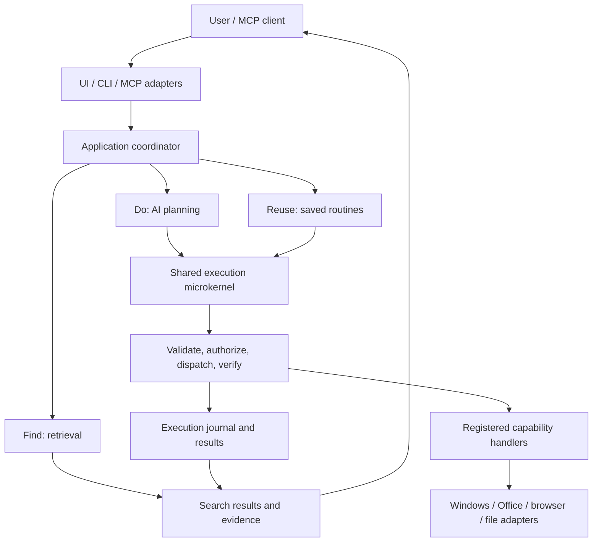

# Aether — Architecture at a Glance

> Proposed architecture · Revision 0.1 · Team review pending

Aether is a local-first Windows assistant built around three workflows: **Find** relevant information, **Do** supported tasks, and **Reuse** verified routines.

For the full technical design, diagrams, directory structure and development approach, see **[ARCHITECTURE.md](ARCHITECTURE.md)**.

## Our proposed architecture

| Style | What it gives us |
|---|---|
| **Modular monolith** | One application, clear functional modules |
| **Hexagonal** | Replaceable external technologies through ports and adapters |
| **Microkernel** | A common execution runtime with registered, extensible capabilities |

Search-only requests do not require fresh AI planning. The planner proposes; the runtime decides whether an operation is eligible and verifies what happened. Resource permissions apply to search as well as execution. A compatible saved routine can run without fresh AI inference.

## Where code belongs

| Package | Responsibility |
|---|---|
| `application/` | Request coordination |
| `core/` | Workflow models, runtime, registry, security |
| `ports/` | Technology-independent contracts |
| `modules/` | Retrieval, planning, routines |
| `adapters/` | Concrete UI, model, OS, library and storage integrations |
| `extensions/` | First-party capability handlers and registration |
| `tests/` | Unit, contract, integration and acceptance evidence |

An adapter is an implementation; a capability is an operation. For example, a spreadsheet adapter may provide several registered operations. Add a new compatible capability by implementing its handler, declaring its schema and effects, registering it and testing its verifier. The core should not need a rewrite.

## First working skeleton

Build a minimal CLI, typed workflow, capability registry, validator, permissions, executor, verifier and journal. Start scoped retrieval and conversion work in parallel. Demonstrate CSV-to-XLSX, add PDF-to-DOCX through the same contract, then integrate local planning and an end-to-end find/convert/open workflow. Keep UI and additional features incremental.

The safety rules apply from the first slice: authorized resources, applicable local approvals, new output files by default, observable success evidence and no blind retry after uncertain effects.

## Further reading

- [Detailed architecture](ARCHITECTURE.md)
- Requirements baseline: `docs/requirements/Aether_Requirements_Baseline.xlsx` (use the actual filename in the repository).

**Status:** This is a design proposal, not a report of implemented capabilities. Version 1.0 scope, model selection, benchmarks and supported application versions remain open.
